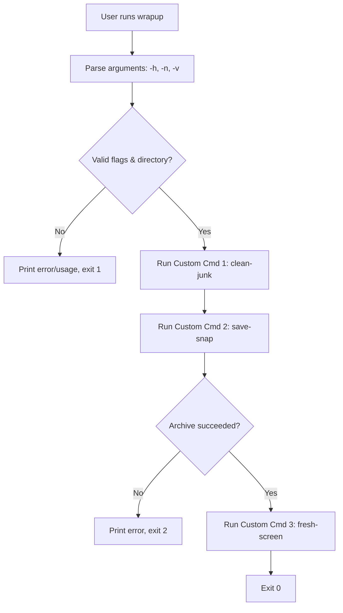

# `wrapup`

> `wrapup` — cleans temporary project junk files, saves a timestamped `.tar.gz` backup snapshot of your current workspace, and resets your terminal screen in one command.

**Team:** Ankit Kulkarni, Sakshi Patil
**Repository:** https://github.com/meankitkulkarni/wrapup-tool
**Date:** 28-10-2026

---

## 1. The problem

### What we keep doing by hand

```bash
find . -maxdepth 2 \( -name "*.tmp" -o -name "*.log" -o -name "__pycache__" \) -exec rm -rf {} +
mkdir -p ~/work_backups
tar -czf ~/work_backups/wrapup-tool_$(date +"%Y%m%d_%H%M%S").tar.gz .
clear
df -h .
```

### Evidence that this is real

```bash
history | grep -E "clear|rm|tar" | wc -l
```

```
84
```

This happens 6 to 10 times a day at the end of every coding interval or lab task. Each time, it breaks our focus, takes 30 to 45 seconds of typing repetitive commands, and risks forgetting to back up our work before clearing the terminal or accidentally archiving temporary junk files.

### Who else has this problem

Several classmates in our Linux lab do the exact same routine—constantly running `clear` after testing scripts and manually compressing folders before making risky code changes. When we asked our lab partner, they mentioned they often forget to delete `.log` and `.tmp` files before zipping their project folders.

---

## 2. Prior art — what already exists

### Tools we found and actually tried

| Tool | Where we found it | What it does | Why it does not solve our problem |
|---|---|---|---|
| `rsync` | `man -k backup` | Syncs files and directories from one location to another. | Copies temporary `.tmp` and `.log` files unless manually excluded each time, does not create timestamped `.tar.gz` interval archives automatically, and does not reset the terminal. |
| `tmpreaper` / `find` | `brew search` / `man -k temp` | Cleans up files in directories based on age or pattern. | Only deletes files; does not take a backup snapshot of the working directory afterward or refresh the terminal workspace. |
| `clear` / `tput reset` | `man -k terminal` | Clears the terminal screen and scrollback buffer. | Only wipes the screen; does not clean project build artifacts or save a backup snapshot of the current coding interval. |

### Evidence of trying them

```bash
# what we ran
rsync -av . ~/work_backups/manual_sync
```

```
# what it printed
building file list ... done
./
debug.log
test.tmp
bin/
bin/clean-junk
bin/fresh-screen
bin/save-snap
bin/wrapup

sent 4,218 bytes  received 168 bytes  8,772.00 bytes/sec
total size is 3,104  speedup is 0.71
```

`rsync` is fast and reliable at copying directory contents to a backup location, which it got right. However, it copied `debug.log` and `test.tmp` directly into our backup directory because it does not clean temporary project junk first, it overwrote the single backup folder instead of saving a timestamped archive per work interval, and we still had to manually clear the terminal and check disk space afterward.

### Where we searched

- [x] `man -k backup` and `man -k clean` — searched the manual pages on our own machines
- [x] GitHub search (`topic:cli-cleanup`, `backup-workflow-sh`)
- [x] Homebrew: `brew search clean` and `brew search backup`
- [x] Stack Overflow — searched "bash script delete temp files backup directory and clear screen"
- [x] npm / PyPI — searched `project-cleanup` and `workspace-backup`
- [x] Asked a human: Asked our teammate and lab classmates, who said they run `rm`, `tar`, and `clear` manually one by one.

### The gap, in one sentence

"Existing tools can do **file deletion (`find`), folder syncing (`rsync`), or screen clearing (`clear`) individually**, but none of them **chain project junk removal, timestamped snapshot archiving, and terminal workspace reset into a single atomic command**, which is the part that actually costs us time."

---

## 3. What we are building

### In scope

- **`clean-junk` (Custom Command 1):** Scans the target directory (up to depth 2) and deletes temporary `.tmp`, `.log`, and `__pycache__` artifacts.
- **`save-snap` (Custom Command 2):** Compresses the cleaned target directory into a timestamped `.tar.gz` archive inside `~/work_backups/`.
- **`fresh-screen` (Custom Command 3):** Clears the terminal screen and prints a clean workspace status banner showing the completion time, current path, and available disk space.
- **`wrapup` (Combined Master Command):** Orchestrates `clean-junk`, `save-snap`, and `fresh-screen` sequentially while supporting `--help`, `--dry-run`, and `--verbose` flags.

### Out of scope

- **Cloud storage uploads (AWS S3 / Google Drive):** Backups are stored strictly locally in `~/work_backups` so the command runs instantaneously offline without requiring network access or API keys.
- **System-wide root directory cleaning:** The tool deliberately restricts cleanup to the target project directory (depth 2) and never touches `/tmp` or `/var` to prevent accidental OS file deletion.

### How we will know it worked

"This tool is successful if it turns **5** commands into **1**, and we actually use it after the assignment ends."

---

## 4. Tech stack

| Choice | What we picked | Why, and what we rejected |
|---|---|---|
| Language | Bash (`#!/usr/bin/env bash`) | Directly executes native Unix utilities and sub-commands with zero startup overhead; rejected Python because wrapping `find`, `tar`, and `clear` inside `subprocess.run()` adds unnecessary complexity. |
| Argument parsing | Native Bash `while` + `case` loop | Supports both short (`-h`, `-n`, `-v`) and long (`--help`, `--dry-run`, `--verbose`) flags with zero external dependencies; rejected `getopts` because standard POSIX `getopts` does not natively support long flags like `--dry-run`. |
| Other dependencies | Standard Unix Coreutils (`find`, `tar`, `df`, `awk`) | Pre-installed on every Linux and macOS machine; rejected third-party tools like `7z` or `fd` so users do not need to install extra packages. |
| Testing | Manual CLI test suite + `--dry-run` verification | Created dummy `.tmp` and `.log` artifacts and verified exit codes (`0`, `1`, `2`) across normal, dry-run, and failure scenarios; rejected heavy unit-test frameworks like `bats` to keep the repository lightweight. |
| Packaging / install method | `install.sh` symlinking to `~/.local/bin` | Installs all four commands globally for the user without requiring `sudo` root permissions; rejected copying files to `/usr/local/bin` so edits in the repository reflect immediately via symlinks. |

### Why this language

We chose Bash because our tool's core job is chaining custom Linux commands together, inspecting shell exit codes (`$?`), manipulating files, and controlling the active terminal screen. Both team members use Bash daily in our Linux coursework, and writing each mini-command as a standalone executable script makes the Unix pipeline architecture clean and easy to inspect.

### What we are deliberately not using

We considered writing the tool in Python using `argparse` and `shutil`, but decided against it because clearing the active shell display and chaining executable shell scripts is much more natural in pure Bash without needing a Python virtual environment.

---

## 5. Architecture



### Components

| Part | Responsibility | File |
|---|---|---|
| Master Wrapper | Parses CLI flags (`--help`, `--dry-run`, `--verbose`), validates inputs, and executes the 3 custom commands in sequence. | `bin/wrapup` |
| Junk Cleaner | Finds and removes `.tmp`, `.log`, and `__pycache__` files in the target folder. | `bin/clean-junk` |
| Snapshot Archiver | Compresses the cleaned working folder into a timestamped `.tar.gz` archive in `~/work_backups/`. | `bin/save-snap` |
| Screen Resetter | Clears the terminal display and prints a workspace summary banner with free disk space. | `bin/fresh-screen` |
| Installer | Sets executable permissions (`chmod +x`), symlinks binaries to `~/.local/bin`, and updates `PATH`. | `install.sh` |

### Data flow

The user runs `wrapup` with optional flags (`-n`, `-v`, `-h`) and an optional target directory path (defaulting to `.`). `wrapup` validates the directory and passes the path and dry-run state into `clean-junk` (which removes matching temporary files from the filesystem), then calls `save-snap` (which reads the directory contents and writes a compressed `.tar.gz` archive into `~/work_backups/`), and finally calls `fresh-screen` (which queries filesystem free space via `df -h` and prints the formatted status header to `stdout`).

### What happens when things go wrong

| If this happens | The tool does this |
|---|---|
| User passes an invalid flag (e.g., `wrapup --nonsense`) | Prints `Error: Unknown flag '--nonsense'. Run 'wrapup --help' for usage.` to `stderr` and exits immediately with code `1`. |
| User passes a directory that does not exist (e.g., `wrapup /missing/folder`) | Prints `Error: Target directory '/missing/folder' not found.` to `stderr` and exits with code `1` before running any sub-commands. |
| Backup creation fails in `save-snap` (e.g., permission denied or disk full) | `save-snap` exits with code `2`, and `wrapup` halts immediately with exit code `2` instead of running `fresh-screen` so the error message is not cleared off the terminal. |

---

## 6. Usage

### Synopsis

```
wrapup [options] [directory]
```

### Commands and flags

| Flag | Long form | What it does | Default |
|---|---|---|---|
| `-h` | `--help` | Show usage and exit | |
| `-n` | `--dry-run` | Show what would happen, change nothing | off |
| `-v` | `--verbose` | Show detailed step-by-step output | off |

### Examples

**Basic use**

```bash
$ wrapup
```

```
==========================================
 Workspace Cleaned & Saved! (23:12:40)
 Current Dir : /Users/ankitkulkarni/wrapup-tool
 Free Space  : 48Gi
==========================================
```

**With a flag**

```bash
$ wrapup --dry-run
```

```
[DRY-RUN] clean-junk: Would remove *.tmp, *.log, and __pycache__ in .
./debug.log
./test.tmp
[DRY-RUN] save-snap: Would save archive to /Users/ankitkulkarni/work_backups/wrapup-tool_20261028_231215.tar.gz
[DRY-RUN] fresh-screen: Would clear terminal and show status summary.
```

**When it fails**

```bash
$ wrapup --nonsense
```

```
Error: Unknown flag '--nonsense'. Run 'wrapup --help' for usage.
```

### Exit codes

| Code | Meaning |
|---|---|
| 0 | Success |
| 1 | Invalid flag or target directory does not exist |
| 2 | Backup snapshot creation failed (`mkdir` or `tar` error) |

### Installation

```bash
git clone [https://github.com/](https://github.com/)meankitkulkarni/wrapup-tool.git
cd wrapup-tool
./install.sh
export PATH="$HOME/.local/bin:$PATH"
```

---

## 7. References

- [GNU Findutils Manual](https://www.gnu.org/software/findutils/manual/html_mono/find.html) — Used to configure `-maxdepth 2` and `-exec rm -rf {} +` safely inside `bin/clean-junk`.
- [GNU Tar Manual](https://www.gnu.org/software/tar/manual/) — Used for the `-czf` compression flags and `-C` directory context switching in `bin/save-snap`.
- [Wooledge BashFAQ/035: How can I handle command-line arguments in Bash?](https://mywiki.wooledge.org/BashFAQ/035) — Used to design the manual `while` + `case` argument parser in `bin/wrapup` rather than `getopts`.
